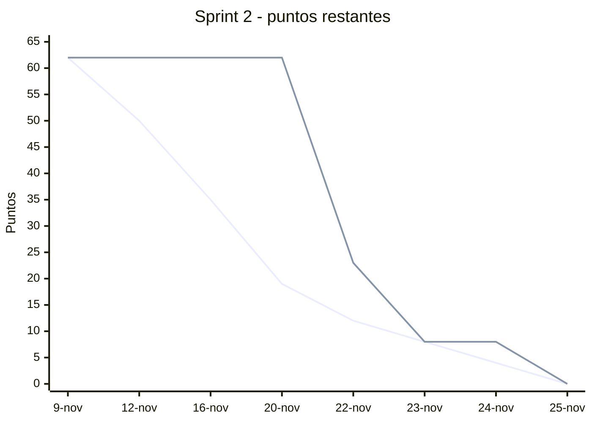

# Sprint 2

## Planeación

**Objetivo:** entregar la Parte 2: infraestructura como código, Kubernetes con Helm,
seguridad, patrones, observabilidad, pruebas avanzadas y rollback, desplegados en AWS
y documentados para la sustentación.

**Fechas en Jira:** 9 al 25 de noviembre de 2026 (fin: 26-nov 03:00 UTC = 25-nov 22:00
Colombia). Entrega documental de la Parte 2 en la HU-28: 22-nov 23:59. Sustentación:
25-nov.

**Alcance comprometido:** 12 historias, **62 puntos**. HU-22 (KAN-34) no se cuenta:
se eliminó del tablero por razones externas ([hu-22-eliminada.md](hu-22-eliminada.md)).

| HU | Jira | Historia | Responsable | Pts | Estado en Jira (24-nov) |
| --- | --- | --- | --- | --- | --- |
| HU-17 | KAN-29 | Aprovisionar infraestructura con Terraform | Daniel Martinez | 8 | Done |
| HU-18 | KAN-30 | Desplegar servicios, web y middleware en Kubernetes | pablo andres guzman | 8 | Done |
| HU-19 | KAN-31 | Integrar Terraform y Helm al pipeline de Jenkins | Rodolfo Moreno | 5 | Done |
| HU-20 | KAN-32 | Bloquear vulnerabilidades críticas y gestionar secretos | pablo andres guzman | 5 | Done |
| HU-21 | KAN-33 | Aplicar RBAC, TLS y autenticación de rutas | Rodolfo Moreno | 5 | Done |
| HU-23 | KAN-35 | Aplicar un feature toggle y demostrar un patrón adicional | NIGORI YT | 5 | Done |
| HU-24 | KAN-36 | Publicar métricas, tableros y alertas | Rodolfo Moreno | 5 | Done |
| HU-25 | KAN-37 | Trazar encuestas y centralizar logs | NIGORI YT | 5 | Done |
| HU-26 | KAN-38 | Ejecutar Locust y OWASP ZAP y analizar resultados | pablo andres guzman | 5 | Done |
| HU-27 | KAN-39 | Documentar versiones y probar rollback con Helm | Daniel Martinez | 3 | Done |
| HU-28 | KAN-40 | Cerrar Sprint 2 y documentar la operación | Daniel Martinez | 5 | In Progress |
| HU-29 | KAN-41 | Ensayar y realizar la sustentación | Sin asignar | 3 | In Progress |

Pendiente del Sprint 1 que siguió abierto: HU-11 (KAN-23, notificación y rollback;
falta Discord) y las subtareas HU-07.2, HU-09.2, HU-10.1, HU-10.2 y HU-15.2, que
siguen en *To Do* en Jira aunque su trabajo quedó cubierto por el pipeline de tags.

## Review

**Incremento entregado:** la release **v1.1.2**, desplegada por el pipeline oficial en
dev, stage y prod de AWS (build `circleguard » v1.1.2` #2, SUCCESS, prod aprobado por
`aprobador`). Evidencia consolidada en [evidencias/sprint-2.md](../evidencias/sprint-2.md).

| Resultado | Evidencia |
| --- | --- |
| 4 entornos en AWS con Terraform: CI + 3 clústeres k3s de 2 nodos | HU-17, plan sin cambios en los tres ambientes |
| 9 releases Helm + middleware en cada ambiente, 9/9 sanos | Etapa *Versiones por ambiente* |
| Pipeline: calidad, Sonar, gitleaks, Trivy, Terraform, Helm, E2E, ZAP y aprobación | HU-19/20, build #2 |
| HTTPS público con Let's Encrypt en dev, stage y prod | Humo + `openssl` (vence 22-feb-2027) |
| RBAC, rutas autenticadas y clave interna entre servicios | HU-21, E2E 5/5 |
| Feature toggle y patrones (Retry + Circuit Breaker, cache-aside, eventos…) | HU-23, `docs/patrones/` |
| Prometheus, Grafana y alertas FIRING/RESOLVED en dev y stage | HU-24, `circleguard-observability` |
| Locust y ZAP: 0 FAIL, 12 WARN de cabeceras | HU-26 |
| Inventario de versiones y rollback real v1.1.2 → v1.1.1 en dev | HU-27 |

**Lo que no se entregó o quedó parcial:**

- **HU-28:** esta documentación (en curso en este PR).
- **HU-29:** la sustentación del 25-nov.
- **Notificaciones:** Discord sin webhook y el correo del pipeline falla (SMTP `530`); las alertas quedan en Alertmanager.
- **Métricas de auth y dashboard:** no se exponían; corregido en PR #64, pendiente de release.
- **Trazas (HU-25) en AWS:** Jaeger y Loki no están instalados en los clústeres.
- **Cabeceras HTTP** (HSTS, CSP, anti-clickjacking): 12 avisos de ZAP, sin corregir.

**Demo de la sustentación:** ver la guía en [informe-parte-2.md](../informe/informe-parte-2.md#9-guion-de-la-sustentación).

## Burndown

Jira cambió todas las historias a *Done* en un solo lote el **24-nov entre 14:01 y
14:02 (Colombia)**. Un burndown con esas fechas sería plano hasta ese día, así que se
construyó con la fecha en que el PR principal de cada HU se integró al repositorio:

| Día | Integrado ese día | Puntos restantes | Ideal |
| --- | --- | --- | --- |
| 9-nov | — | 62 | 62 |
| 12-nov | — | 62 | 50 |
| 16-nov | (ramas abiertas de HU-18, HU-20, HU-26) | 62 | 35 |
| 20-nov | — | 62 | 19 |
| 22-nov | HU-26 (#45), HU-18 (#44), HU-20 (#43), HU-17 (#48), HU-27 (#49), HU-24 (#51), HU-21 (#50): 39 pts | 23 | 12 |
| 23-nov | HU-19 (#52), HU-25 (#53), HU-23 (#55): 15 pts | 8 | 8 |
| 24-nov | Release v1.1.2 desplegada; Jira pasa 10 HU a *Done* | 8 | 4 |
| 25-nov | HU-28 (este PR) y HU-29 (sustentación) | 0 (previsto) | 0 |

La línea que baja recta es la ideal; la otra es la real. El 25-nov es una previsión.

**Lectura:** el trabajo se desarrolló en ramas desde el 16-nov, pero no se integró
hasta los tres últimos días: 54 de 62 puntos entraron entre el 22 y el 23-nov. Eso
explica las correcciones de integración de los días 23 y 24 (releases 1.1.0 → 1.1.2).

## Retrospectiva

> Borrador con hechos verificables del repositorio, de Jenkins y de Jira. El equipo lo
> confirma o ajusta.

| Qué pasó | Impacto | Acción |
| --- | --- | --- |
| 54 de 62 puntos se integraron entre el 22 y el 23-nov | Defectos de integración visibles solo al final: tres releases en dos días | PR pequeños e integración diaria a `dev` desde el primer día |
| Jira se actualizó en un lote el último día | El tablero no sirvió para seguir el sprint | Mover la tarjeta en el mismo momento en que se integra el PR |
| v1.1.0 salió con dependencias vulnerables y un login roto | Hubo que estabilizar (#55) y sacar v1.1.1 y v1.1.2 | No etiquetar sin el pipeline completo verde en `main` |
| El commit 69cba57 quitó la cabecera `X-Internal-Api-Key` de auth → identity | Todo login válido daba 503; lo detectó el E2E | Se restauró y la prueba ahora falla sin la cabecera |
| `resilience.yml` reemplazó la lista de endpoints de Actuator | auth y dashboard sin métricas y alertas siempre activas | PR #64 con una prueba de regresión |
| El chart de Neo4j imprimió la clave en el log de Jenkins | Exposición de dos credenciales | Rotación en stage/prod y PR #61 |
| La evidencia de alertas filtraba solo por nombre | Un FIRING falso en el primer intento | El script identifica la alerta por etiquetas y la exige inactiva antes |
| Terraform quería reemplazar el worker al detenerlo | Plan bloqueado por `check-plan.mjs` | `ignore_changes` y verificación con los ambientes detenidos |
| Control de costos con stage/prod apagados | Gasto estimado < USD 25 | Mantener el encendido solo para pruebas |

**Qué hicimos bien:**

- Los controles automáticos detuvieron problemas reales antes de prod: Trivy, el bloqueo
  de planes destructivos, el E2E y la aprobación manual.
- La misma imagen inmutable recorrió dev, stage y prod con el registro de aprobación.
- Ningún secreto se subió a Git; la exposición en logs se detectó y se rotó el mismo día.

**Qué mejorar:**

- Integrar temprano y en lotes pequeños.
- Mantener Jira al día.
- Probar la observabilidad (targets y alertas) en el mismo PR que la cambia.

**Acciones si hubiera un Sprint 3:**

- Desplegar PR #64 y repetir la verificación de targets.
- Configurar Discord.
- Instalar Jaeger y Loki en AWS.
- Corregir las cabeceras que reporta ZAP.
- Excluir `**/node_modules` en Trivy fs.
- Pasar la clave de Neo4j por `passwordFromSecret`.
