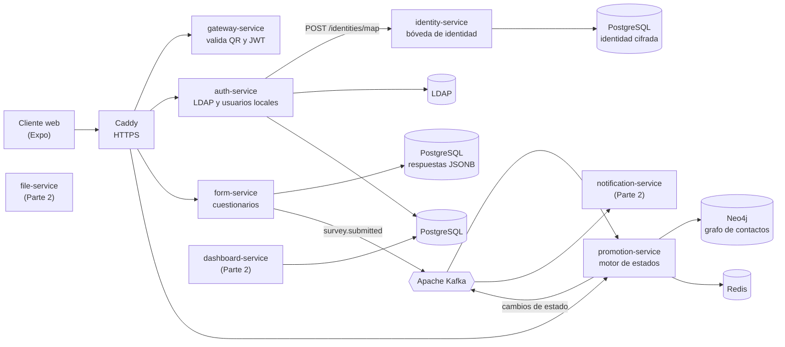
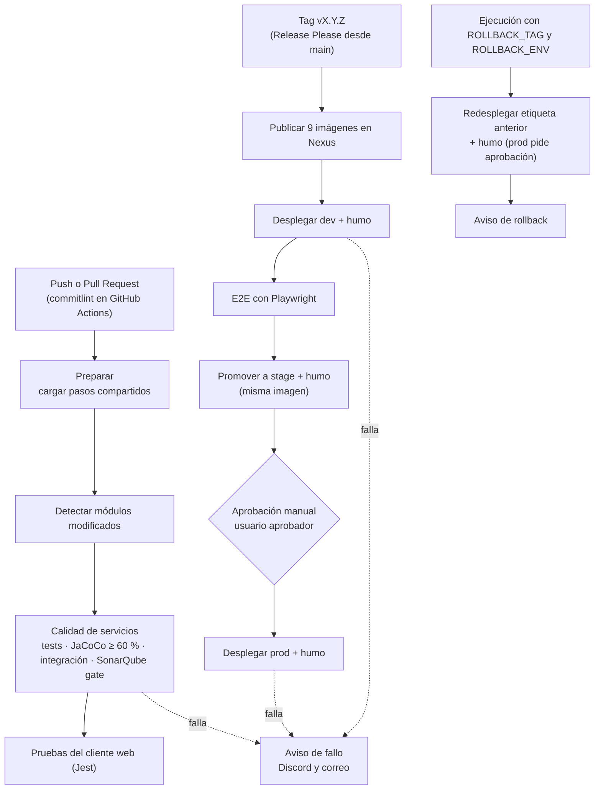
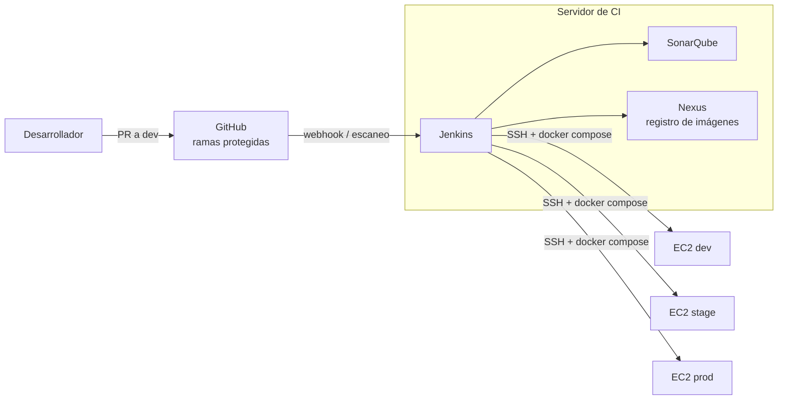

# Arquitectura y pipeline de CircleGuard

Diagramas en Mermaid: GitHub los dibuja directamente al abrir este archivo.

## 1. Arquitectura de la aplicación

La Parte 1 despliega auth, identity, promotion, form, gateway, el cliente web y el middleware. notification, file y dashboard se compilan, prueban y publican, pero quedan detrás del perfil `part2` de Compose.

## 2. Pipeline de CI/CD (Jenkins)

La misma imagen inmutable (la etiqueta `vX.Y.Z` publicada en Nexus) recorre dev, stage y prod; el rollback reutiliza una etiqueta ya publicada sin reconstruir imágenes.

## 3. Infraestructura

