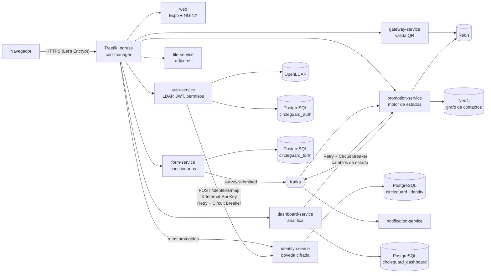
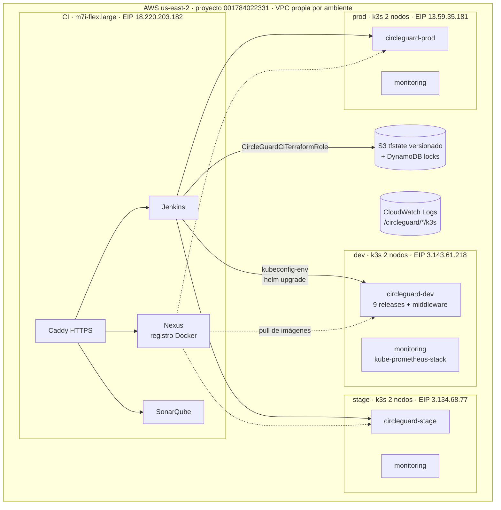
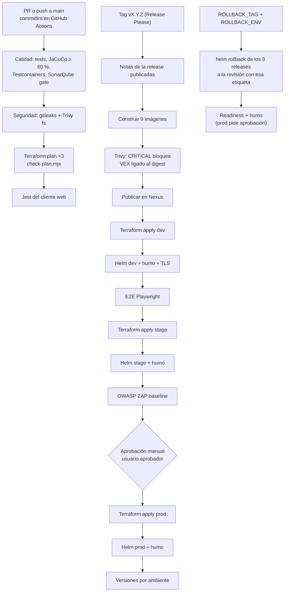

# Arquitectura y pipeline de CircleGuard

Estado verificado el 24 de noviembre de 2026: release **v1.1.2** en dev, stage y prod
(AWS `us-east-2`). Diagramas en Mermaid: GitHub los dibuja al abrir este archivo.
La versión de la Parte 1 (Compose por SSH) está en el historial de Git y en
[informe-parte-1.md](informe/informe-parte-1.md).

## 1. Arquitectura de la aplicación

notification-service no tiene Ingress: solo consume eventos de Kafka.

- **Base de datos por servicio:** una instancia de PostgreSQL con cinco bases y usuario propio.
- **Eventos:** Kafka desacopla form → promotion → notification.
- **Cache-aside:** el estado de salud se sirve desde Redis/Caffeine.
- **Máquina de estados:** las transiciones de salud se validan en promotion.
- **Retry + Circuit Breaker (Resilience4j):** auth → identity y dashboard → promotion.
- **Feature toggle (HU-23):** ver [patrones/](patrones/README.md).
- **Seguridad (HU-21):** cerrada por defecto. Solo login, verificación de QR y
  `/actuator/health|prometheus` son públicos dentro del clúster; las llamadas internas
  exigen `X-Internal-Api-Key`; los permisos salen de roles (migración V6 de auth).

## 2. Infraestructura en AWS (HU-17)

| Pieza | Implementación |
| --- | --- |
| Terraform | Módulos `network`, `cluster`, `environment`; raíces `envs/ci`, `dev`, `stage`, `prod`; estado remoto por ambiente |
| Cómputo | m7i-flex.large (2 vCPU, 8 GiB); k3s servidor + worker por ambiente |
| Acceso | SSH y API 6443 limitados al operador y a CI; tráfico entre nodos solo dentro de su security group |
| Protección | `prevent_destroy` en CI; `check-plan.mjs` bloquea bajas y reemplazos en el pipeline; `ignore_changes` en la IP pública del worker |
| Identidad | Jenkins asume `CircleGuardCiTerraformRole` (sin access keys); nodos con permissions boundary (SSM + logs) |
| DNS / TLS | Nombres sslip.io sobre las EIP; cert-manager 1.21.3 y Let's Encrypt (ACME HTTP-01 por Traefik) |
| Costos | [costos.md](costos.md) |

## 3. Pipeline de CI/CD (HU-19, HU-20, HU-27)

La misma imagen inmutable `vX.Y.Z` recorre dev, stage y prod; el rollback reutiliza
revisiones Helm existentes y no reconstruye imágenes.

## 4. Observabilidad (HU-24, HU-25)

- **Métricas:** cada servicio expone `/actuator/prometheus`; `ServiceMonitor` por
  servicio; dashboards técnico y de negocio en Grafana.
- **Alertas:** `CircleguardServiceDown`, `High5xxRate`, `GateDenialSpike`,
  `ContainmentSlaBreach` y `AvailabilityLow`, probadas con `promtool`. Alertmanager
  agrupa y notificaría a Discord si hubiera webhook (pendiente).
- **Trazas y logs:** agente OpenTelemetry en el chart y logs con `traceId`. Jaeger y
  Loki se instalan con `observability/trazas-logs/`; **no** están instalados en los
  clústeres de AWS.

## 5. Estado y límites conocidos

| Tema | Estado |
| --- | --- |
| auth y dashboard sin `/actuator/prometheus` | Corregido en PR #64; pendiente de release |
| Notificaciones | Discord sin webhook y SMTP con `530 Authentication Required`: hoy solo queda Alertmanager |
| Cabeceras HTTP (HSTS, CSP, X-Frame-Options) | 12 avisos de ZAP sin corregir |
| Trivy fs y `node_modules` anidados | Falso positivo en workspaces reutilizados; excluir `**/node_modules` |
| Trazas en AWS | Jaeger/Loki sin instalar |
