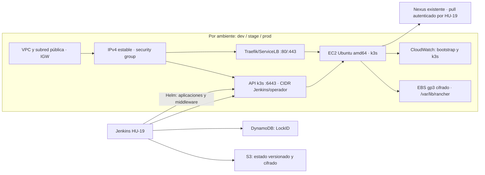

# HU-17 · Ambientes reproducibles con Terraform

Rama `hu-17`, creada desde `feat/hu-19-pipeline-terraform-helm`. Los cinco
módulos se llaman `network`, `cluster`, `registry`, `storage` y `observability`.
`modules/environment` los compone una sola vez; los roots `envs/dev`, `stage`
y `prod` son iguales y cambian sus `terraform.tfvars` y su clave de backend.

## Infraestructura implementada



- `network`: VPC aislada, subred, ruta al IGW, EIP y reglas de firewall.
  SSH y API exigen CIDR explícitos /24 o más restrictivos. HTTP/HTTPS atienden
  el Ingress; no se exponen puertos de bases de datos.
- `cluster`: un nodo EC2 por ambiente, Ubuntu amd64 con AMI fijada, IMDSv2,
  disco de sistema cifrado, rol SSM y k3s `v1.34.13+k3s1`. El instalador espera
  el disco y la conectividad. k3s exige el montaje del disco también al reiniciar.
- `registry`: integra el Nexus existente; produce `registries.yaml` para
  containerd sin secretos. `registry_http=true` configura un endpoint HTTP;
  por defecto usa HTTPS y verifica su certificado. Jenkins administra el
  `imagePullSecret` con `nexus-registry`. No se crea ECR ni un registro duplicado.
- `storage`: EBS gp3 cifrado, montado en `/var/lib/rancher`, donde k3s guarda
  sus datos y los PVC de `local-path`. Sobrevive stop/start. **Destroy elimina
  el volumen y sus datos**; respaldar antes. Kafka sigue en `emptyDir` hasta
  resolver el pendiente de HU-18: este módulo no lo convierte en persistente.
- `observability`: grupo CloudWatch con retención por ambiente y envío de los
  logs de cloud-init/k3s. Prometheus, Grafana y alertas siguen en HU-24.

Es una topología de laboratorio de un nodo por ambiente, sin alta disponibilidad.
No sustituye las VM CloudFormation de Sprint 1 ni las importa automáticamente.

## Cuenta, costos y configuración pendiente

Al preparar esta HU el operador informó que su **Free plan agotó los créditos**.
No se ejecutaron llamadas AWS, `plan` contra AWS, `apply`, `destroy` ni cargas de
credenciales en Jenkins. La [documentación de planes de AWS](https://docs.aws.amazon.com/awsaccountbilling/latest/aboutv2/free-tier-plans.html)
explica la diferencia entre Free y Paid. No activar Paid sin revisar presupuesto.

Los `tfvars` y `backend.hcl` contienen una cuenta `000000000000`, una AMI ficticia,
CIDR TEST-NET y `registry.example.invalid`. Son **plantillas que hay que completar**,
no ambientes aprovisionados. El proveedor y el backend restringen la cuenta
mediante `allowed_account_ids`.

Antes de cualquier apply:

1. Confirmar cuenta autorizada, plan, presupuesto y región (propuesta `us-east-2`).
2. Autenticarse con un perfil local o credenciales temporales, nunca en Git:
   `export AWS_PROFILE=circleguard`.
3. Ejecutar `bash infra/terraform/scripts/preflight.sh <cuenta> us-east-2` y
   guardar su salida. Revisar vCPU EC2, VPC, EIP, capacidad gp3 y recursos ya
   activos. Los ejemplos proponen 3 instancias `t3.xlarge` (12 vCPU en total),
   3 EIP y discos de datos de 60/80/100 GiB; ajustar al presupuesto y a la carga.
4. Elegir una AMI Ubuntu amd64 de confianza de esa región y fijar su ID, un
   key pair existente y CIDR /32 de operador/Jenkins para 22 y 6443. No usar
   las redes 10.10/20/30 de CloudFormation ni la red de pods k3s 10.42/16.
5. Completar la cuenta en `backend.hcl` y `terraform.tfvars` de los tres roots.
   Completar el hostname real de Nexus y permitir que los nodos alcancen su
   puerto en el firewall del host de CI. `127.0.0.1:5000` no sirve desde EC2.

EIP, EBS, S3, DynamoDB, logs y transferencia pueden generar costos. **Stop no
equivale a costo cero**: conserva discos/EIP. No hay NAT Gateway, EKS ni un
load balancer AWS en esta propuesta. Para ahorrar puede demostrarse cada
ambiente por turnos y destruirlo antes de crear el siguiente, si el equipo lo acuerda.

## Bootstrap y uso con HU-19

Se fijan Terraform **1.9.8** (igual que Jenkins) y proveedor AWS **5.100.0** con
lockfiles. DynamoDB se mantiene por el criterio de aceptación y compatibilidad
con esta versión. Su bloqueo está deprecado en Terraform reciente; al actualizar
se debe acordar la migración, no quitarlo silenciosamente.

```bash
# Solo con la cuenta y los costos confirmados. Bootstrap una vez.
terraform -chdir=infra/terraform/bootstrap init -input=false
terraform -chdir=infra/terraform/bootstrap plan -var='account_id=CUENTA' -out=tfplan
terraform -chdir=infra/terraform/bootstrap apply tfplan

# Repetir para dev/stage/prod; revisar el plan antes de aplicar.
terraform -chdir=infra/terraform/envs/dev init -input=false -backend-config=backend.hcl
terraform -chdir=infra/terraform/envs/dev validate
terraform -chdir=infra/terraform/envs/dev plan -input=false -lock-timeout=5m -out=tfplan
terraform -chdir=infra/terraform/envs/dev apply -input=false tfplan
bash infra/terraform/scripts/verify-no-changes.sh dev
bash infra/terraform/scripts/verify-lock.sh dev
```

El bootstrap crea S3 versionado/cifrado, bloqueo público, política que exige TLS
y DynamoDB on-demand con `LockID`, cifrado y recuperación puntual. Ambos tienen
`prevent_destroy`: destruir un ambiente no borra su historial ni el backend
compartido. Custodiar el estado local del bootstrap; puede migrarse después a
`circleguard/bootstrap/terraform.tfstate` añadiendo su backend S3 y usando
`init -migrate-state`. No mezclarlo con el estado de un ambiente.

Cada root usa `circleguard/<ambiente>/terraform.tfstate`. El usuario de Terraform
requiere permisos de EC2/VPC/EBS, IAM para el rol de instancia, CloudWatch y del
backend (S3 List/Get/Put y DynamoDB Describe/Get/Put/DeleteItem). No necesita
credenciales de aplicación. El contrato de HU-19 conserva `aws-terraform` y
`kubeconfig-dev/stage/prod`.

El apply crea recursos AWS pero no espera por cloud-init. Verificar primero
`sudo cloud-init status --wait` en el nodo. Exportar el kubeconfig:

```bash
bash infra/terraform/scripts/export-kubeconfig.sh dev /ruta/segura/llave.pem /ruta/segura/dev.kubeconfig
KUBECONFIG=/ruta/segura/dev.kubeconfig kubectl -n kube-system get pods
```

La llave se queda fuera del repositorio. Verificar la huella SSH por SSM/u otro
canal confiable. El kubeconfig exportado tiene permisos administrativos:
subirlo a Jenkins como Secret file `kubeconfig-dev` y restringir quién puede
usarlo. HU-21 debe acordar credenciales limitadas con los permisos que requiere
HU-19. Repetir para stage/prod.

## Ingress, DNS y TLS

k3s trae **Traefik**, CoreDNS, metrics-server, ServiceLB y `local-path`. Los
values por ambiente usan `ingress.className: traefik`. No se instala
ingress-nginx. Cert-manager/TLS siguen en HU-21: ajustar su solver al mismo
IngressClass y revisar anotaciones específicas de nginx antes de integrarla.

Crear un registro DNS hacia la EIP de cada ambiente y sustituir los hosts
`.local` en `deploy/helm/envs/*.yaml`, CORS y `SITE_ADDRESS` de Jenkins por los
hosts reales. HU-19 necesita HTTPS operativo para humo y E2E. La EIP evita
regenerar certificados/kubeconfigs después de stop/start. Sus costos continúan
hasta liberarla con destroy.

## Evidencia y cierre diario

`verify-lock.sh` abre un `terraform console` real que mantiene el lock, observa
`Info` en DynamoDB, ejecuta otro plan con timeout corto y exige el error de
bloqueo. Cierra la consola, comprueba que el lock desapareció y exige un plan
correcto. No simula locks con escrituras manuales ni usa `force-unlock`.

`verify-no-changes.sh` exige exit code **0** de `plan -detailed-exitcode`; 1 es
error y 2 indica cambios. HU-19 también ejecuta este control tras cada apply.
Las salidas locales quedan en `.local-evidence/hu-17/`, fuera de Git. Resumir
resultados reales en `docs/evidencias/hu-17.md`; no subir estado, planes, llaves,
kubeconfigs ni salidas que contengan secretos.

```bash
# Fin de jornada: revisar el ID que devuelve output antes de apagar.
terraform -chdir=infra/terraform/envs/dev output -raw instance_id
aws ec2 stop-instances --region us-east-2 --instance-ids ID_CONFIRMADO
# Al regresar:
aws ec2 start-instances --region us-east-2 --instance-ids ID_CONFIRMADO

# Cierre definitivo: respaldar datos, revisar el plan y destruir SOLO ese root.
terraform -chdir=infra/terraform/envs/dev plan -destroy -out=tfplan-destroy
terraform -chdir=infra/terraform/envs/dev apply tfplan-destroy
```

Repetir el cierre para stage/prod. El backend se conserva deliberadamente hasta
archivar todas las evidencias/estados; su eliminación exige un cierre separado
y coordinado del equipo. No borrar recursos ajenos ni las VM de Sprint 1.

## Verificación local sin AWS

```bash
terraform fmt -check -recursive infra/terraform
for root in envs/dev envs/stage envs/prod bootstrap modules/environment; do
  terraform -chdir="infra/terraform/$root" init -backend=false -input=false
  terraform -chdir="infra/terraform/$root" validate
done
terraform -chdir=infra/terraform/bootstrap test
terraform -chdir=infra/terraform/modules/environment test
```

Los tests usan `mock_provider`: no acreditan aprovisionamiento ni un bloqueo real.
Estado y resultados: [evidencias HU-17](evidencias/hu-17.md).
