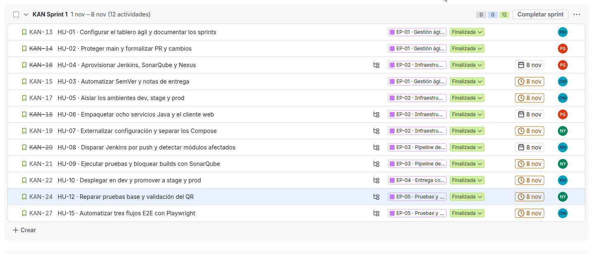
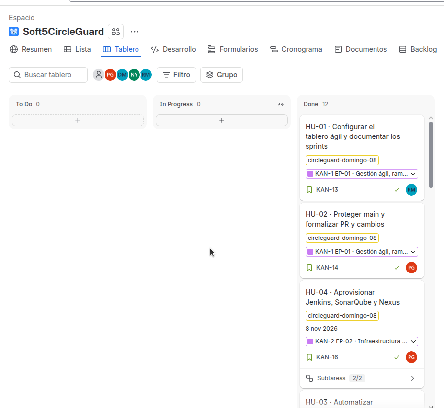

# Informe · Parte 1 (Taller 3) · CircleGuard

Ingeniería de Software V · Universidad Icesi · Entrega: domingo 8 de noviembre de 2026, 11:59 p. m.

Repositorio de trabajo: https://github.com/pabloandressoftware/CircleGuardSoft5Comentarios
Tablero: Jira, proyecto KAN (`seraph.atlassian.net`)

Equipo: Pablo Andrés Guzmán Alarcón (`pabloandressoftware`), Daniel Martínez Alvarado (`damaral2005`), Rodolfo Moreno Gutiérrez (`Matatrolls`), Nicolás Góngora Rincón (`itsnigori98`).

Video de la demo (3 min): [`docs/video/video_arEawg9t.mp4`](../video/video_arEawg9t.mp4)

> Este informe distingue entre lo **verificado con ejecución**, lo que tiene **código integrado sin evidencia de ejecución** y lo **no implementado**. El registro del uso de IA está en el anexo al final.

## 1. Resumen

CircleGuard es un sistema universitario de rastreo de contactos y cercos sanitarios que preserva el anonimato. Se compone de 8 microservicios (Java 21, Spring Boot, Gradle), un cliente Expo/React Native con salida web y servicios de soporte (PostgreSQL, Neo4j, Kafka, Redis, OpenLDAP). El código base no traía contenedores, pipelines, infraestructura declarativa ni pruebas de extremo a extremo.

La Parte 1 lleva el proyecto desde el commit hasta el despliegue: gobierno del repositorio, aprovisionamiento de Jenkins, SonarQube y Nexus, empaquetado en imágenes Docker, pipeline multibranch con análisis de calidad, versionado automático, ambientes en AWS y pruebas E2E con Playwright.

## 2. Marco ágil y tablero

- **Marco:** Scrum (sprints 0, 1 y 2) con un tablero Kanban en Jira. La justificación completa está en `docs/agil/marco.md`.
- **Backlog:** 12 épicas, 29 historias de usuario y 144 puntos. Cada HU tiene criterios de aceptación, puntos, responsable e iteración en su descripción, y las HU grandes tienen subtareas.
- **Alcance acordado del Sprint 1 (esta entrega):** 10 historias y 49 puntos: HU-03, 04, 05, 06, 07, 08, 09, 10, 12 y 15. HU-01 y HU-02 pertenecen al Sprint 0. HU-11, 13, 14 y 16 quedaron **fuera del alcance acordado de esta entrega** y pasan al siguiente sprint. La Parte 2 (Sprint 2) cubre HU-17 a HU-29.
- **Fuentes del estado:** Jira (corte de hoy), el repositorio y el documento del equipo «Sprint 1 · Pendientes por persona» (corte del 6 de noviembre). Lo que proviene de ese documento se cita como «según los registros del equipo (corte 6-nov)» y no se presenta como verificado para este informe.
- **Documentación de sprints:** `docs/agil/sprint-0.md` y `docs/agil/sprint-1.md` (planeación, review y retrospectiva). Sprint 0: 28 de octubre al 1 de noviembre de 2026; Sprint 1: 2 al 8 de noviembre de 2026. Las retrospectivas son un borrador con hechos del repositorio que el equipo confirma; queda pendiente solo la demo del Sprint 1.

**Evidencia del tablero (Jira, 8 de noviembre de 2026).** Backlog del *KAN Sprint 1* con las 12 HU finalizadas y su responsable, y vista de tablero con las columnas *To Do*, *In Progress* y *Done*:





| Rol | Responsabilidad | Persona |
| --- | --- | --- |
| A | Gestión ágil, versiones y E2E | Daniel Martínez Alvarado |
| B | Infraestructura | Pablo Andrés Guzmán Alarcón |
| C | Pipeline y despliegue | Rodolfo Moreno Gutiérrez |
| D | Configuración y calidad | Nicolás Góngora Rincón |

## 3. Estrategia de ramas y gobierno (HU-02)

```
hu-XX  ->  dev  ->  main
```

- **Una rama por HU** (`hu-01` … `hu-15`). Las que dependen de otra la heredan: `hu-04` parte de `hu-05` y `hu-08` parte de `hu-04`.
- **Entrada a `dev` solo por Pull Request.** Cada PR indica el responsable según Jira y lo aprueba otra persona; el autor no aprueba su propia HU.
- **`main` y `dev` están protegidas** y las reglas valen también para el propietario del repositorio:

| Regla | `main` | `dev` |
| --- | --- | --- |
| PR obligatorio con 1 aprobación | Sí | Sí |
| Checks requeridos | `commitlint` y `continuous-integration/jenkins/pr-merge` | `commitlint` |
| Sin push forzado ni borrado | Sí | Sí |
| Rama al día antes de mergear | Sí | No |
| Conversaciones resueltas | Sí | Sí |

- **commitlint** valida Conventional Commits en cada PR mediante GitHub Actions (`.github/workflows/commitlint.yml`).
- **Plantillas** de PR y de solicitud de cambio con tipo, riesgo y rollback, y una tabla de aprobadores por tipo de cambio en `docs/gobernanza/cambios.md`.

**Limitación:** el check de Jenkins está exigido en `main`, pero Jenkins todavía no lo publica en este repositorio (faltan un Jenkins accesible desde GitHub, el token y el webhook). Hasta entonces `main` no admite merges.

## 4. Arquitectura de CI/CD

```
push / PR ──► GitHub ──webhook──► Jenkins (multibranch + Shared Library)
                                   │
                  detectar módulos modificados (HU-08)
                                   │
        compilar, pruebas, JaCoCo ──► SonarQube (quality gate ≥ 60 % en código nuevo)
                                   │
        pruebas del cliente web (Jest)
                                   │
        tag vX.Y.Z ──► empaquetar 9 imágenes ──► Nexus (registro Docker)
```

| Pieza | Qué hace | HU |
| --- | --- | --- |
| `infra/bootstrap/bootstrap-ci.sh` | Levanta Jenkins, SonarQube (con PostgreSQL) y Nexus con Docker Compose, en local (`--local`) o en una VM de AWS (`--aws`). Es repetible. | HU-04 |
| JCasC + `plugins.txt` | Configura Jenkins por código: Shared Library `circleguard`, job multibranch, agente con etiqueta `docker`. | HU-04, HU-08 |
| Quality gate `CircleGuard` | Falla si la cobertura del código nuevo es menor a 60 %. | HU-04 |
| `Dockerfile` (ARG `SERVICE`) | Imagen multi-stage: compila con JDK 21 y ejecuta con JRE 21 y usuario sin privilegios. | HU-06 |
| `mobile/Dockerfile` | `expo export` y nginx sin privilegios. | HU-06 |
| `scripts/package-images.sh` | Construye y publica las 9 imágenes (8 servicios y la web) en Nexus. | HU-06 |
| `Jenkinsfile` unificado | Pipeline declarativo: disparo `githubPush`, parámetro `BUILD_ALL`, detección de módulos (HU-08), calidad y gate bloqueante (HU-09), pruebas del web y publicación solo en tags `vX.Y.Z`. | HU-08, HU-09 |
| release-please | Calcula la versión SemVer a partir de Conventional Commits y publica tags y notas de versión. | HU-03 |
| `infra/bootstrap/bootstrap-env.sh` | Crea una VM con Docker en AWS EC2 por ambiente (dev, stage, prod) con CloudFormation. | HU-05 |
| `deploy/` (Compose) | Compose por ambiente con proxy HTTPS (Caddy), healthchecks y variables externalizadas. | HU-07 |
| `e2e/` (Playwright) | Pruebas de login, cuestionario y QR, con etapa `circleGuardE2E` para Jenkins. | HU-15 |

## 5. Estado de las historias de usuario

Criterios: **verificado** = se ejecutó y se observó el resultado al preparar este informe; **registros del equipo** = consta en el documento «Sprint 1 · Pendientes por persona» (corte 6-nov) o en `docs/sprint-1-persona-*.md`, sin reproducirse aquí; **código integrado** = está en `dev` sin evidencia de ejecución.

### Alcance acordado del Sprint 1 (10 HU, 49 puntos)

| HU | Historia | Pts | Responsable (Jira) | Jira | Evidencia |
| --- | --- | --- | --- | --- | --- |
| HU-03 | Versionado y releases | 3 | Daniel Martínez Alvarado | Finalizada | Código integrado (release-please, `version.txt`). Según los registros del equipo: en progreso, verificando el tag SemVer contra el commit; falta integrar release-please en `main` y confirmar el permiso para abrir el PR de release. |
| HU-04 | Jenkins, SonarQube y Nexus | 8 | Pablo Andrés Guzmán Alarcón | Finalizada | **Verificado en local:** el bootstrap levanta el stack, dos ejecuciones no duplican recursos, el gate exige 60 % de cobertura nueva, credenciales fuera del repo. Registros del equipo: servidor de CI aprovisionado en EC2 con bootstrap repetido. No probado por mí: modo `--aws` y un análisis que falle el gate. |
| HU-05 | Ambientes en AWS | 5 | Daniel Martínez Alvarado | Finalizada | Código integrado. Registros del equipo: tres VM en Ohio (`us-east-2`) para dev, stage y prod, bootstrap repetido y aislamiento de PostgreSQL entre dev y prod comprobado. Falta el Compose y los valores de HU-07, los archivos de entorno en Jenkins y las URL HTTPS. |
| HU-06 | Imágenes Docker | 5 | Pablo Andrés Guzmán Alarcón | Finalizada | **Verificado en local:** 9 imágenes (8 servicios y la web) construidas y publicadas con etiqueta `v0.0.1` en un Nexus local, usuario sin privilegios y HEALTHCHECK en las 9. Registros del equipo: nueve imágenes `v0.0.1` comprobadas en Nexus. |
| HU-07 | Variables y Compose | 5 | Nicolás Góngora Rincón | Finalizada | Código integrado en `dev` (`deploy/`, variables de entorno). Registros del equipo: faltaba evidencia del Compose definitivo por ambiente. |
| HU-08 | Multibranch y webhook | 5 | Rodolfo Moreno Gutiérrez | Finalizada | Evidencia **documentada por su responsable** en `docs/sprint-1-persona-c.md`: build iniciado 5,3 s después del push, build selectivo de un servicio en 22 s, `BUILD_ALL` y cambio en la raíz. No reproducida aquí. |
| HU-09 | Pruebas y quality gate | 5 | Nicolás Góngora Rincón | Finalizada | Código integrado (JaCoCo, gate bloqueante, publicación limitada a tags). **Verificado en un Jenkins local:** el pipeline unificado de HU-08 y HU-09 se ejecutó con `BUILD_ALL` sobre `dev` con HU-10; compiló y probó los 8 servicios (56 de 58 pruebas pasan), publicó los reportes JUnit y JaCoCo y se detuvo en 2 pruebas de `promotion` cuyo contenedor de Neo4j no arrancó a tiempo, sin llegar al análisis de SonarQube. En una ejecución posterior falló solo 1 prueba (`AdministrativeCorrectionTest`) y `HealthStatusReevaluationTest` pasó, lo que muestra que dependen del tiempo de arranque de Neo4j; ambas clases se pausaron con `@Disabled` en el PR #23 hasta corregir HU-14. Registros del equipo: SonarQube ya tiene el gate de 60 %. |
| HU-10 | Despliegue y promoción | 5 | Rodolfo Moreno Gutiérrez | Finalizada | Código integrado (PR #21): despliegue en dev con prueba de humo, E2E, promoción de la misma etiqueta a stage y aprobación manual de prod, solo en tags `vX.Y.Z`. **Sin evidencia de ejecución:** requiere un tag de release y las VM de AWS. |
| HU-12 | QR y pruebas base | 3 | Nicolás Góngora Rincón | Finalizada | Código integrado (vigencia del QR en milisegundos, acceso denegado a `SUSPECT`, `PROBABLE` y `CONFIRMED`; PR #13 mergeado). Registros del equipo (6-nov): el gateway dejaba pasar `SUSPECT`; el fallo se corrigió con este cambio, **Verificado en Jenkins local:** las pruebas de `identity` (8), `form` (6) y `promotion` HealthStatus (4) pasan, y las del cliente web (Jest) pasan 13 de 13. |
| HU-15 | Pruebas Playwright | 5 | Daniel Martínez Alvarado | Finalizada | Código integrado. Registros del equipo: Chromium validado en Jenkins y 4 de 5 casos pasaron en local; el de `SUSPECT` fallaba hasta la corrección de HU-12. No se ha ejecutado la suite completa desde Jenkins. |

### Sprint 0 (previo)

| HU | Historia | Pts | Responsable (Jira) | Jira | Evidencia |
| --- | --- | --- | --- | --- | --- |
| HU-01 | Tablero ágil y sprints documentados | 3 | Rodolfo Moreno Gutiérrez | Finalizada | Documentos en `docs/agil/` integrados. Fechas y retrospectivas integradas (#19). Pendientes: la demo del Sprint 1 y confirmar el acceso del docente al tablero. |
| HU-02 | Proteger `main` y formalizar PR | 3 | Pablo Andrés Guzmán Alarcón | Finalizada | **Verificado:** protección activa en `main` y `dev`, commitlint pasando en GitHub Actions, plantillas y tabla de aprobadores. **Parcial:** el check de Jenkins no se publica aún. |

### Fuera del alcance acordado de esta entrega (pasan al siguiente sprint)

HU-11 (notificar fallos y rollback), HU-13 (60 % de cobertura en cinco servicios), HU-14 (tres integraciones con Testcontainers) y HU-16 (documentar operación y evidencias). No se implementaron porque no estaban en el alcance acordado. Este informe y los documentos `docs/sprint-1-persona-*.md` son la documentación de operación disponible hoy.

**Resumen:** al cierre del 8 de noviembre las 12 HU de los sprints 0 y 1 figuran como Finalizadas en Jira (capturas en la sección 2). La columna **Evidencia** indica el nivel real de verificación: solo HU-02, 04 y 06 se verificaron con ejecución propia; el resto tiene código integrado en `dev` y, en algunos casos, evidencia documentada por su responsable. La mayor brecha es que el pipeline unificado no llegó a ejecutarse de punta a punta (se detuvo en pruebas de `promotion` por el arranque lento de Neo4j) y que HU-10 tiene código integrado pero sin evidencia de ejecución.

## 6. Problemas encontrados y cómo se resolvieron

| Problema | Impacto | Resolución |
| --- | --- | --- |
| Las branch rules no se pueden configurar en la organización `ingesoft5` (plan GitHub Team) | HU-02 no era viable en el repositorio original | Se creó el repositorio bajo la cuenta de `pabloandressoftware` (público, donde las reglas son gratuitas), se migraron todas las ramas con su historial y se reconstruyó `dev` con un PR por HU. Se conserva `dev-respaldo` con el `dev` anterior. |
| El mirror de plugins de Jenkins (`ftp.halifax.rwth-aachen.de`) estuvo caído | `bootstrap-ci.sh` se colgó 17 minutos | Se fijó `JENKINS_UC_DOWNLOAD` a otro mirror en el Dockerfile de Jenkins. Queda como dependencia externa. |
| HU-08 y HU-09 modifican el mismo `Jenkinsfile` con diseños distintos | Conflicto al integrar la segunda | Se unieron en un solo pipeline declarativo que conserva los elementos de ambas. Se validó la sintaxis de Groovy y el pipeline unificado se ejecutó después en un Jenkins local (ver HU-09 en la sección 5). |
| Un PR de HU se envió a `main` en lugar de `dev` | PR cerrado y trabajo repetido | Se cerró y se abrió otro PR hacia `dev`; los PR de HU-09 y HU-12 se redirigieron a `dev` cambiando su base. El flujo `hu-XX -> dev -> main` quedó documentado. |
| Las pruebas de backend fallaban en Jenkins (10 pruebas en `identity`, `form` y `promotion`) | El pipeline con `BUILD_ALL` se detenía en la etapa de calidad | Causas raíz: `jwt.secret` ausente en el `application.yml` de prueba (identity), una prueba de `form` que exigía PostgreSQL real, un rol simulado sin el prefijo `ROLE_` (promotion) y Testcontainers 1.19 incompatible con Docker 29 (API 1.32 frente al mínimo 1.40). Se corrigieron en HU-10 (#21) y en el PR #20; quedan 2 pruebas por el arranque lento de Neo4j en la máquina de prueba. |
| La regla `subject-case` de commitlint rechazaba asuntos con siglas (`URLs`, `JaCoCo`) | Fallaban los PR de HU-07 y HU-09 | Se desactivó solo esa regla; el resto de Conventional Commits sigue validándose. |
| Las aprobaciones se descartaban solas cuando `dev` cambiaba | Un PR aprobado volvía a «revisión requerida» | Se desactivó «descartar aprobaciones antiguas» en `dev`. |
| Una rama de HU nueva no tenía el check commitlint | El check es obligatorio y no corría | Se actualizó la rama con `dev` para que el workflow se ejecutara. |

## 7. Limitaciones y trabajo pendiente

- **Check de Jenkins en `main`:** exigido pero sin publicar. Falta un Jenkins accesible desde internet, un token de GitHub y el webhook. La demostración del webhook de HU-08 usó un túnel smee.io.
- **Pipeline de punta a punta:** el `Jenkinsfile` unificado se ejecutó en un Jenkins local con `BUILD_ALL` y recorrió todas las etapas de calidad, pero se detuvo en 2 pruebas de `promotion` (Neo4j no arrancó a tiempo). Por eso no se alcanzó el análisis de SonarQube, no se probó el gate bloqueando una cobertura menor a 60 % y no corrieron las etapas de web, publicación y despliegue.
- **AWS:** el modo `--aws` del bootstrap y la publicación en el Nexus de AWS no se probaron. La URL HTTPS de la aplicación por ambiente está pendiente (DNS y TLS).
- **Dentro del alcance y sin evidencia de ejecución:** HU-10 (despliegue y promoción), porque depende de un tag de release y de las VM de AWS.
- **Fuera del alcance acordado de esta entrega:** HU-11 (notificaciones y rollback), HU-13 (cobertura de 60 % en cinco servicios), HU-14 (Testcontainers) y HU-16 (documentación de operación).
- **Deuda conocida:** `file-service` guarda archivos dentro del contenedor; hay carpetas `services/*/bin/` del IDE versionadas.
- **Jira:** las 12 HU de los sprints 0 y 1 quedaron en Finalizada el 8 de noviembre. La fuente de verdad sobre qué se ejecutó y comprobó es la columna Evidencia de la sección 5, no el estado del tablero.

## 8. Contribución individual

La trazabilidad sale del historial de GitHub y de Jira (corte del 8 de noviembre de 2026). Los commits cuentan los de `dev` sin merges; los PR son los del repositorio de trabajo.

| Integrante | HU responsable (Jira) | PR mergeados | Commits | PR aprobados |
| --- | --- | --- | --- | --- |
| Pablo Andrés Guzmán Alarcón (`pabloandressoftware`) | HU-02, HU-04, HU-06 | #1 y #6 (HU-02), #10 (commitlint), #11 (HU-04), #5 (HU-06) | 10 | 8 |
| Daniel Martínez Alvarado (`damaral2005`) | HU-03, HU-05, HU-15 | #15 (HU-03), #14 (HU-05), #16 (HU-15) | 3 | 3 |
| Rodolfo Moreno Gutiérrez (`Matatrolls`) | HU-01, HU-08, HU-10 | #8 (HU-01), #9 (HU-08), #21 (HU-10) | 6 | 6 |
| Nicolás Góngora Rincón (`itsnigori98`) | HU-07, HU-09, HU-12 | #7 (HU-07), #12 (HU-09), #13 (HU-12) | 9 | 0 |

Otros aportes y aclaraciones:

- **Pablo Andrés:** migró el repositorio a su cuenta y reconstruyó `dev` con un PR por HU, configuró la protección de `main` y `dev` y commitlint, redactó este informe y los documentos de HU-01 (#18 y #19), corrigió la compatibilidad de Testcontainers con Docker 29 (#20) y ejecutó el pipeline unificado en un Jenkins local de pruebas.
- **Rodolfo:** abrió el PR de HU-01 (#8), cuyos documentos escribió la cuenta de Pablo, y en HU-10 (#21) corrigió también las pruebas de backend de `identity`, `form` y `promotion`. Sus commits aparecen con el nombre «Seraph» en Git.
- **Daniel:** según los registros del equipo, aprovisionó el servidor de CI y las tres VM de AWS en Ohio. Esa infraestructura no está en el repositorio, así que no se reproduce aquí.
- **Nicolás:** aporta el mayor número de commits después de Pablo; sus HU son HU-07, HU-09 y HU-12.
- Los PR #1 a #5 del repositorio original de la organización (`ingesoft5`) no se migraron; su contenido sí está en el historial.
- Cada PR indica en su cuerpo el responsable de Jira y los aprobadores válidos; el responsable de una HU no aprueba la suya.

## 9. Declaración de uso de IA generativa

Siguiendo la regla del curso (nivel 3: colaboración permitida con declaración de uso y registro de prompts), el equipo declara que se usó **Claude Code** (Anthropic) para:

- verificar la ejecución local de HU-04 y HU-06 (levantar el stack, construir y publicar las imágenes);
- migrar el repositorio, repartir el trabajo en una rama por HU y configurar la protección de ramas;
- redactar la configuración de commitlint, las plantillas de PR y de cambio, y la documentación de HU-01, HU-02 y este informe;
- resolver el conflicto del `Jenkinsfile` entre HU-08 y HU-09.

Todo resultado fue revisado por el equipo antes de integrarse mediante PR con aprobación de otra persona. Lo que no se pudo ejecutar se declara como tal en este informe.

## Anexo · Bitácora de uso de IA

**Método.** El equipo trabajó con Claude Code (Anthropic) como asistente de ingeniería sobre el repositorio, la cuenta de Jira y un Jenkins local de pruebas. Las preguntas de esta bitácora están **reformuladas** a partir de la conversación real para que se lean con claridad; el registro textual completo de la sesión puede entregarse a solicitud del docente. Cada fila muestra qué se preguntó, qué hizo el asistente y qué **decidió o verificó una persona**. No se incluyen contraseñas ni tokens.

**Reglas de control que se mantuvieron durante todo el proceso**

- El asistente no integró ningún PR sin aprobación de otra persona, y las acciones sensibles (crear el repositorio público, reescribir historia, tocar reglas de protección, mergear PR propios) pasaron por un control de permisos que las bloqueó hasta tener autorización explícita.
- Lo que el asistente no pudo ejecutar se declaró como tal: modo `--aws`, gate fallando por cobertura, check de Jenkins en `main`.
- El asistente leyó el servidor de AWS solo con permiso, en modo lectura, y no usó una llave privada compartida por chat.

| # | Pregunta al asistente (reformulada) | Qué hizo la IA | Decisión y verificación humana |
| --- | --- | --- | --- |
| 1 | «Hice tres commits con la cuenta de un compañero. ¿Puedes pasarlos a mi usuario sin tocar el código?» | Analizó la rama, explicó que reescribir historia exige un `force-push` y pidió elegir entre reescribir o abrir una rama nueva. Reescribió autor y committer y comprobó que el diff contra la versión anterior estaba vacío. | Pablo eligió reescribir. Se verificó en GitHub que los tres commits aparecen a su nombre y que el contenido no cambió. |
| 2 | «¿Qué piden realmente los criterios de HU-04 y HU-06 y cómo lo demostramos con evidencia y no con fe?» | Leyó los criterios en Jira por API, los comparó con el código y levantó Jenkins, SonarQube y Nexus en local. Ejecutó el bootstrap dos veces comparando contenedores, volúmenes y redes, y publicó las 9 imágenes. | Se aceptó como verificado solo lo ejecutado; el modo `--aws` y un gate que falle se dejaron declarados como no probados. |
| 3 | «El profesor dice que las branch rules no funcionan en la organización. ¿Cómo migramos sin perder historial y dejamos una rama por HU?» | Propuso un repositorio nuevo, subió las 19 ramas con sus SHA, repartió los 40 archivos de un bloque en ramas por HU y comprobó que su suma era idéntica a `dev` (diff vacío). Configuró protección de `main` y `dev`, commitlint y plantillas. | El equipo validó el plan, creó el repositorio público y aceptó las invitaciones. La equivalencia se comprobó con `git diff`. |
| 4 | «¿Qué riesgo corremos si borramos `dev` y metemos cada HU por su propio PR?» | Expuso el costo (unas 12 aprobaciones encadenadas y un `dev` incompleto mientras tanto) y una alternativa más ligera. Creó `dev-respaldo` antes del reset. | Pablo eligió el reset completo. Al final se verificó que `dev` quedó igual al respaldo más lo nuevo, sin archivos perdidos. |
| 5 | «Cada PR debe salir a nombre de su responsable en Jira y lo aprueba otra persona. ¿Cómo lo automatizamos?» | Explicó que no puede suplantar cuentas, propuso enlaces de PR prellenados, un script y un workflow, y dejó la regla en la plantilla de PR. | Cada integrante abrió su propio PR; las aprobaciones fueron personas distintas del autor y del responsable. |
| 6 | «HU-08 y HU-09 chocan en el `Jenkinsfile`. ¿Puedes unirlos sin romper ninguno?» | Leyó los dos diseños, escribió un pipeline declarativo que conserva ambos y validó la sintaxis de Groovy en un contenedor. | Se pidió probarlo en Jenkins: se ejecutó con `BUILD_ALL` y recorrió todas las etapas de calidad. |
| 7 | «El pipeline con `BUILD_ALL` falla. ¿Es el código o es el entorno?» | Leyó los reportes JUnit y separó cuatro causas: `jwt.secret` ausente en el yml de prueba, una prueba que exigía PostgreSQL, un rol simulado sin `ROLE_` y Testcontainers 1.19 incompatible con Docker 29. Corrigió y probó dentro del contenedor de Jenkins. | Rodolfo llegó al mismo diagnóstico en HU-10, así que el PR se redujo al arreglo de Docker 29. Dos pruebas de Neo4j se pausaron con `@Disabled` y quedan para HU-14. |
| 8 | «¿Por qué dices que mi disco es lento?» | Midió en vez de suponer: 300 escrituras con `fsync` tardaron 59 s en un disco mecánico de 5400 rpm, y relacionó eso con los timeouts de PostgreSQL y Neo4j. | Pablo decidió no mover Docker al NVMe antes de la entrega. |
| 9 | «¿Cómo vamos frente al enunciado?» | Cometió un error: tomó la fecha de un PDF preliminar (15 de noviembre). Al ver el correo del 28 de octubre se retractó y recalibró el alcance a 10 HU y 49 puntos. | El equipo aportó el correo y el documento «Pendientes por persona», que corrigieron la lectura del asistente. |
| 10 | «¿Necesitas algo de AWS?» | Con permiso, hizo solo lecturas: no halló recursos de CircleGuard en esa cuenta y alertó de que las credenciales de la máquina eran de la cuenta root, recomendando rotarlas. | El servidor de CI real no se usó: el firewall no estaba abierto y se prefirió no operar un recurso compartido sin coordinación. |
| 11 | «Redacta el informe mientras tú pruebas el pipeline.» | Lanzó un agente en paralelo que escribió el informe con evidencia graduada (verificado, registros del equipo, código integrado) y un guion de video. | El equipo revisó el informe, completó nombres y contribución individual, y lo integró por PR con aprobación. |

**Errores del asistente y cómo se corrigieron** (parte del proceso, no se ocultan)

- Dio por buena una fecha de entrega equivocada (ver fila 9) y la corrigió con el correo del profesor.
- Un borrado de volúmenes de Docker con un `.env` vacío falló sin avisar y dejó contraseñas viejas; se repitió con el `.env` correcto.
- Canceló por error un build de `dev` al filtrar mal la cola de Jenkins; se relanzó.
- Anunció HU-11, 13, 14 y 16 como pendientes cuando no estaban en el alcance acordado; se corrigió al leer el documento del equipo.
