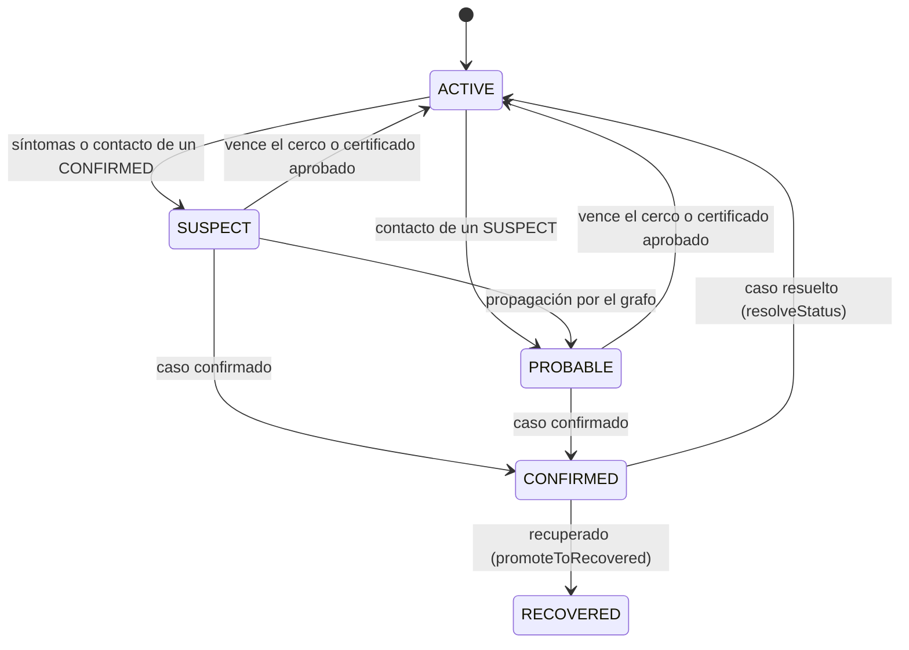

# Máquina de estados del estado de salud

## Propósito

El estado de salud decide si una persona entra al campus, así que no puede cambiar de
cualquier forma. La **máquina de estados** fija los estados posibles y las transiciones
permitidas, y rechaza las que no lo son (por ejemplo, volver a `ACTIVE` dentro del cerco
obligatorio). Así el comportamiento es predecible y se puede probar transición por transición.

## Estados y transiciones

Transición **rechazada**: `SUSPECT` o `PROBABLE` → `ACTIVE` dentro del cerco obligatorio
(14 días por defecto) lanza `FenceException`, salvo *override* de un administrador.

`RECOVERED` es la ventana de inmunidad: su clave en Redis vence a los 30 días. Después de eso
la puerta ya no encuentra estado y trata a la persona como sin riesgo.

| Estado | Significado | ¿Entra al campus? (gateway, HU-12) |
| --- | --- | --- |
| `ACTIVE` | Sin riesgo conocido | Sí |
| `SUSPECT` | Reportó síntomas o es contacto directo de un caso confirmado | No |
| `PROBABLE` | Contacto de un sospechoso (segundo nivel) | No |
| `CONFIRMED` | Caso confirmado | No |
| `RECOVERED` | Recuperado, con ventana de inmunidad | Sí |
| Cualquier otro | Dato inesperado | No (la puerta falla cerrada) |

## Dónde está

`services/circleguard-promotion-service/src/main/java/com/circleguard/promotion/service/HealthStatusService.java`:

- `updateStatus(...)`: aplica el cambio y lo **propaga** por el grafo en una sola consulta
  Cypher: `CONFIRMED` marca a sus contactos como `SUSPECT`, y `SUSPECT` marca a los suyos
  como `PROBABLE`. No degrada a quien ya está en `CONFIRMED` o `RECOVERED`.
- `checkFenceWindow(...)`: **rechaza** la transición a `ACTIVE` si la persona está en
  `SUSPECT` o `PROBABLE` dentro del cerco obligatorio (14 días por defecto), lanzando
  `FenceException`. Solo un administrador puede forzarla (`adminOverride`).
- `resolveStatus(...)`: libera a los contactos que ya no tienen ningún camino de riesgo.
- `promoteToRecovered(...)`: pasa a `RECOVERED` y deja la clave de Redis con 30 días de vida.

`services/circleguard-promotion-service/src/main/java/com/circleguard/promotion/listener/SurveyListener.java`:
una encuesta con síntomas pasa a `SUSPECT`; un certificado aprobado pide volver a `ACTIVE`
(sujeto a la validación del cerco).

`services/circleguard-promotion-service/src/main/java/com/circleguard/promotion/service/StatusLifecycleService.java`:
tarea programada que cada hora devuelve a `ACTIVE` a quienes cumplieron su cerco, actualiza
Redis y publica `promotion.status.changed`.

Cada transición publica un [evento](eventos.md) y actualiza la [caché](cache-aside.md).

## Trade-offs

| Se gana | Se paga |
| --- | --- |
| Solo hay transiciones válidas; las inválidas fallan con un error claro | Las reglas están repartidas entre Cypher (propagación) y Java (validación del cerco); un cambio exige revisar y probar ambos |
| La propagación por el grafo es una sola transacción (meta de < 1 s del análisis) | Una consulta Cypher grande es más difícil de leer y depurar que código Java |
| El paso automático a `ACTIVE` no depende de que alguien lo haga a mano | La liberación ocurre cada hora: puede haber hasta una hora de diferencia con la fecha exacta |
| La puerta es predecible: cada estado tiene una respuesta definida | Agregar un estado nuevo obliga a actualizar promotion, gateway y las pruebas |

## Evidencia

- `services/circleguard-promotion-service/src/test/java/com/circleguard/promotion/service/HealthStatusServiceTest.java`:
  `shouldThrowExceptionWhenUpdatingStatusToActiveWithinFenceWindow` (transición rechazada) y
  `shouldAllowOverrideWhenWithinFenceWindow` (override de administrador).
- `services/circleguard-promotion-service/src/test/java/com/circleguard/promotion/service/StatusLifecycleTest.java`:
  `automaticTransition_ReleasesExpiredUsers` (paso automático a `ACTIVE`).
- `services/circleguard-gateway-service/src/test/java/com/circleguard/gateway/service/QrValidationServiceTest.java`:
  la respuesta de la puerta para cada estado.
