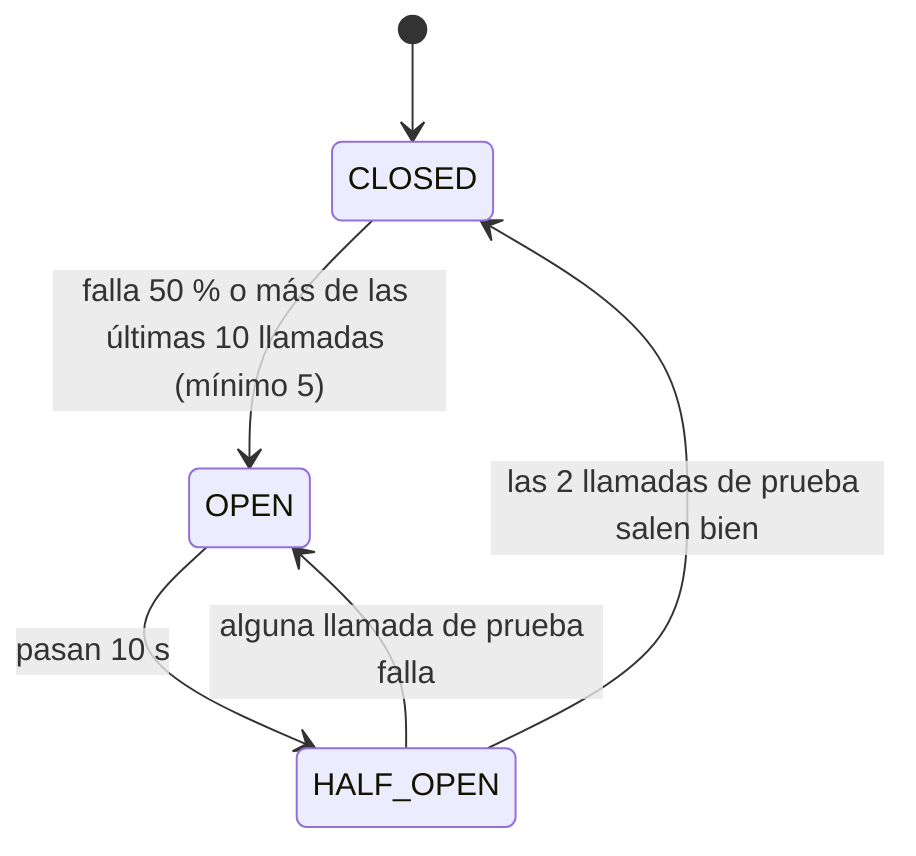

# Retry y Circuit Breaker (HU-22)

## Propósito

Cuando un servicio llama a otro por HTTP, la llamada puede fallar: el otro servicio se
reinicia, se cae o responde lento. Sin protección, el que llama se queda esperando y su
propio usuario recibe un error tarde y poco claro. Antes de esta historia, si identity-service
caía, el login se quedaba sin timeout y terminaba en un **500 "Internal server error"**.

Se combinan tres mecanismos:

| Mecanismo | Qué hace | Problema que evita |
| --- | --- | --- |
| **Timeout** | Corta la llamada si no conecta o no responde a tiempo | Hilos y usuarios esperando indefinidamente |
| **Retry** | Repite una vez la llamada que falló por un problema pasajero | Fallar por un parpadeo de red o un reinicio rápido |
| **Circuit Breaker** | Si fallan demasiadas llamadas seguidas, deja de llamar por un tiempo y responde al instante | Insistir sobre un servicio caído y alargar cada respuesta |
| **Fallback** | Lo que se responde cuando no hay más intentos o el circuito está abierto | Un 500 genérico o un dato inventado |

## Dónde está

Se usa **Resilience4j** con sus anotaciones de Spring Boot. Las dependencias están en el
`build.gradle.kts` de auth y dashboard (`resilience4j-spring-boot3`, `spring-boot-starter-aop`
y `spring-boot-starter-actuator`).

### auth-service → identity-service

`services/circleguard-auth-service/src/main/java/com/circleguard/auth/client/IdentityClient.java`

```java
@Retry(name = "identity", fallbackMethod = "identityUnavailable")
@CircuitBreaker(name = "identity")
public UUID getAnonymousId(String realIdentity) { ... }

private UUID identityUnavailable(String realIdentity, Throwable cause) {
    throw new IdentityUnavailableException("identity-service no disponible", cause);
}
```

- El `RestTemplate` se construye con timeouts de conexión y lectura.
- El fallback **no inventa** un `anonymousId`: sin identity no se puede emitir un token válido
  sin romper la privacidad, así que informa el error.
- `LoginController` captura `IdentityUnavailableException` y responde **503**:

```http
HTTP/1.1 503 Service Unavailable
Retry-After: 10

{ "code": "IDENTITY_UNAVAILABLE",
  "message": "El servicio de identidad no esta disponible. Intenta de nuevo en unos segundos." }
```

`Retry-After` indica cuándo vuelve a intentarlo el circuito (el tiempo que pasa abierto).

### dashboard-service → promotion-service

`services/circleguard-dashboard-service/src/main/java/com/circleguard/dashboard/client/PromotionClient.java`

Mismo esquema (`@Retry(name = "promotion")` y `@CircuitBreaker(name = "promotion")`). El
fallback devuelve el mismo mapa de error que el dashboard ya manejaba
(`{"error": "Service unavailable", ...}`), así que `AnalyticsService` no cambia. Antes, un
`try/catch` dentro de cada método atrapaba el error y el circuito nunca lo veía; se quitó
para que Resilience4j cuente los fallos.

### notification-service (ya existía)

Los envíos de correo, SMS y push usan **Spring Retry** (`@Retryable(maxAttempts = 3,
backoff = @Backoff(delay = 2000))` en `EmailServiceImpl`, `SmsServiceImpl` y
`PushServiceImpl`). Ahí no hace falta Circuit Breaker: el envío es asíncrono y nadie espera
la respuesta en línea.

## Cómo funciona

Los decoradores se aplican en este orden: `Retry( CircuitBreaker( llamada HTTP ) )`.



| Estado | Qué pasa con el login si identity está caído |
| --- | --- |
| `CLOSED` | Intenta llamar a identity; si falla, reintenta una vez y responde 503 |
| `OPEN` | No llama a identity: responde 503 **al instante**. El Retry **no** reintenta (`CallNotPermittedException` está en `ignore-exceptions`) |
| `HALF_OPEN` | Deja pasar 2 llamadas de prueba para ver si identity volvió |

Solo cuentan como fallo los errores de red (`ResourceAccessException`) y las respuestas
5xx (`HttpServerErrorException`). Un 4xx es un error de quien llama, no de identity, y no
abre el circuito.

## Configuración

Los valores están en `src/main/resources/resilience.yml` de cada servicio (importado desde
`application.yml`) y los timeouts en `application.yml`. Todos se pueden cambiar por
variable de entorno sin tocar el código. Para promotion las variables empiezan por
`PROMOTION_` en lugar de `IDENTITY_`.

| Parámetro | Valor | Variable (auth) |
| --- | --- | --- |
| Timeout de conexión | 200 ms | `IDENTITY_CONNECT_TIMEOUT` |
| Timeout de lectura | 250 ms | `IDENTITY_READ_TIMEOUT` |
| Intentos (incluye el original) | 2 | `IDENTITY_RETRY_ATTEMPTS` |
| Espera entre intentos | 50 ms | `IDENTITY_RETRY_WAIT` |
| Ventana del circuito | últimas 10 llamadas | `IDENTITY_CB_WINDOW` |
| Mínimo de llamadas para evaluar | 5 | `IDENTITY_CB_MIN_CALLS` |
| Porcentaje de fallos que abre | 50 % | `IDENTITY_CB_FAILURE_RATE` |
| Tiempo abierto | 10 s | `IDENTITY_CB_OPEN_WAIT` |

**Presupuesto de latencia (criterio 3):** peor caso con el circuito cerrado =
2 × (200 + 250) ms + 50 ms = **950 ms**, por debajo del segundo que propone el análisis. Con
identity apagado la conexión se rechaza en milisegundos, así que en la práctica es mucho
menos. Con el circuito abierto la respuesta es casi inmediata.

## Trade-offs

| Se gana | Se paga |
| --- | --- |
| El login responde rápido y con un mensaje claro aunque identity esté caído | Mientras el circuito está abierto (10 s) se rechazan también logins que habrían funcionado si identity ya volvió |
| No se satura a identity con reintentos cuando ya está caído | Timeouts cortos (250 ms de lectura) pueden cortar una respuesta legítima pero lenta; el Retry lo compensa, a cambio de una llamada extra |
| El reintento absorbe fallos pasajeros (reinicio, parpadeo de red) | Un reintento duplica la carga sobre un servicio que está sufriendo; por eso es solo 1 y nunca con el circuito abierto |
| El estado del circuito se ve en `/actuator/circuitbreakers` | Más configuración que entender y ajustar; los valores se eligieron por el análisis y deben validarse con carga real |
| El dashboard sigue mostrando la pantalla con un aviso en vez de fallar | El fallback del dashboard muestra datos incompletos; la pantalla debe dejarlo claro |

**Por qué no un fallback "optimista" en el login:** se podría dejar entrar con un token sin
`anonymousId` o con uno temporal, pero eso rompería la privacidad (el token debe llevar la
identidad anónima real) y daría acceso sin validar. Se prefiere fallar de forma controlada.

## Evidencia

### Pruebas automáticas

| Prueba | Qué demuestra |
| --- | --- |
| `services/circleguard-auth-service/src/test/java/com/circleguard/auth/client/IdentityClientResilienceTest.java` | Con identity apagado: error controlado en < 1 s, reintento contado por el circuito, el circuito se abre tras 3 logins fallidos y luego rechaza en < 100 ms sin llamar a identity |
| `services/circleguard-auth-service/src/test/java/com/circleguard/auth/controller/LoginControllerTest.java` (`shouldReturnControlledErrorWhenIdentityIsUnavailable`) | El login responde 503 con `Retry-After`, `code` y mensaje, sin emitir token |
| `services/circleguard-dashboard-service/src/test/java/com/circleguard/dashboard/client/PromotionClientResilienceTest.java` | Con promotion apagado: fallback en < 1 s y el circuito se abre |

Las pruebas usan la configuración real (`resilience.yml`) y las anotaciones dentro de un
contexto de Spring, no una simulación del circuito. Imprimen los tiempos medidos, por ejemplo
`HU-22 evidencia: identity apagado -> error controlado en 45 ms`. Para correrlas (desde la
raíz del repo, con Docker):

```bash
docker run --rm -v "$PWD":/workspace -w /workspace \
  -v circleguard-gradle-cache:/home/gradle/.gradle gradle:8.14.5-jdk21 \
  gradle --no-daemon :services:circleguard-auth-service:test :services:circleguard-dashboard-service:test
```

### Prueba manual en un ambiente (dev)

En la VM, con un usuario de prueba válido (si las credenciales son incorrectas el login
responde 401 antes de llamar a identity):

```bash
cd /opt/circleguard
HOST=<PublicDns-dev>          # el mismo de SITE_ADDRESS en el .env
sudo docker compose stop identity-service

# 4 logins seguidos: código HTTP y tiempo total
for i in 1 2 3 4; do
  curl -sk -o /dev/null -w "%{http_code} %{time_total}s\n" -X POST "https://$HOST/api/v1/auth/login" \
    -H 'Content-Type: application/json' -d '{"username":"USUARIO","password":"CLAVE"}'
done

# Estado del circuito dentro de auth (no se publica por el proxy)
sudo docker compose exec -T auth-service curl -s localhost:8180/actuator/circuitbreakers

sudo docker compose start identity-service
```

Resultado esperado: cuatro respuestas `503` en menos de 1 s, las últimas casi instantáneas,
y `"identity": {"state": "OPEN", ...}` en el actuator. A los 10 s de volver identity, el
circuito pasa a `HALF_OPEN` y luego a `CLOSED`, y el login vuelve a responder 200.
